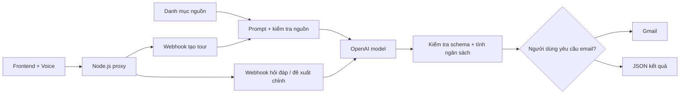

# Backend Firebase đã được áp dụng

Dự án sử dụng n8n Cloud qua `N8N_TRIP_URL` và `N8N_GUIDE_URL` trong `.env`. Khởi động backend bằng `npm.cmd start`; khi chuyển tài khoản Cloud, cập nhật hai Production URL rồi khởi động lại backend.

Kết quả kiểm tra ngày 23/10/2026: [REVIEW-2026-10-23.md](REVIEW-2026-10-23.md). Local qua kiểm thử; n8n thật đang trả HTTP 500 và Firestore còn thiếu chỉ mục phục hồi job/email.

Đọc [BACKEND-FIREBASE.md](BACKEND-FIREBASE.md) để cấu hình đăng nhập, Firestore và chạy backend mới. Hướng dẫn backend cũ bên dưới được giữ để tham khảo; AI/lưu cloud hiện yêu cầu Firebase và đăng nhập.

# Vietjourney · AI Tourism v3

Ứng dụng lập lịch trình du lịch Việt Nam bằng AI, dùng frontend HTML/CSS/JavaScript, server Node.js và workflow n8n v3 **30 node** (v2 có 29). Có demo không cần API, hướng dẫn viên bằng giọng nói, email, lưu trên trình duyệt và xuất lịch trình.

## Chạy ứng dụng

Yêu cầu Node.js 20+. Chạy `npm.cmd install` để cài dependency Firebase Admin. Không cần Python hoặc `.venv`.

```powershell
Copy-Item .env.example .env # Chỉ chạy nếu chưa có .env
npm.cmd start
```

Mở http://localhost:3000. Nếu cổng đã được sử dụng, dừng server cũ bằng Ctrl+C. Để đọc `.env` mới, phải khởi động lại server. API key OpenAI và Gmail OAuth nằm trong Credentials của n8n, không đặt trong frontend.

## Chuyển từ workflow v2 sang v3

1. Import `workflows/AI Tourism v3.json` thành **workflow mới** trong n8n. Workflow v2 và file v2 được giữ để quay lại khi cần.
2. Gán credential cho `10 · OpenAI chat model` và `19 · Send itinerary Gmail` như workflow đang chạy. Một model được nối với cả lập tour và hướng dẫn viên.
3. Publish/activate v3. Hai Production URL mới là `/webhook/generate-trip-v3` và `/webhook/virtual-guide-v3`. Không dùng `/webhook-test/` cho ứng dụng thường xuyên.
4. Sau khi publish, chuyển `.env` sang các URL mới. Có thể dùng:

   ```powershell
   node scripts/use-workflow.mjs v3
   ```

   Lệnh giữ nguyên tên miền và các thiết lập còn lại. Nếu n8n có URL đặc biệt hoặc proxy có prefix riêng, nhập chính xác Production URL từ node Webhook thay vì dùng lệnh trên.
5. Dừng server cũ, chạy lại `npm.cmd start`, tải lại frontend.
6. Bỏ chọn demo; tạo tour không gửi email trước. Kết quả phải có bảng 6 khoản ngân sách và khối nguồn tham khảo. Sau đó thử chat ở chế độ **Chỉnh tour**. Chỉ gửi email khi người dùng tích chọn và cung cấp địa chỉ.

Quay về URL v2 bằng `node scripts/use-workflow.mjs v2` rồi khởi động lại server. Frontend vẫn đọc được tour v2; tour v2 không có đủ dữ liệu để chỉnh bằng tính năng v3.

Nếu bật Header Auth trên webhook: dùng header `X-Tourism-Key`, đặt cùng giá trị với `N8N_WEBHOOK_SECRET` trong `.env`. Chỉ điền biến này chưa đủ để bật bảo vệ; cần bật trên cả hai node webhook trong n8n.

## Ngân sách đầy đủ

- Vé khứ hồi: đơn giá/người × số người. Không dùng một giá mặc định cho mọi điểm xuất phát. Nếu chưa xác nhận, kết quả ghi rõ còn thiếu khoản này.
- Lưu trú: đơn giá/phòng/đêm × `ceil(số người / người mỗi phòng)` × `max(số ngày - 1, 0)`. Có tùy chọn đã có chỗ ở, không cộng tiền phòng.
- Ăn uống: đơn giá/người/ngày × số người × số ngày.
- Di chuyển tại chỗ: đơn giá/cả nhóm/ngày × số ngày.
- Vé / trải nghiệm: cộng các hoạt động có category `activities`; chi phí vé là cho cả nhóm.
- Dự phòng: phần trăm tổng ngân sách người dùng; đây là khoản để dành, không phải tiền đã chi.

Tổng dự toán = 6 khoản trên. Các hoạt động ăn, ở và di chuyển có cost=0 vì đã nằm trong bảng ngân sách; UI và email ghi rõ cách tính để tránh cộng hai lần. Không có chức năng đặt vé/đặt phòng hoặc báo giá trực tiếp.

Các đơn giá mặc định (phòng 600.000 đ, ăn 200.000 đ/người/ngày, di chuyển 300.000 đ/nhóm/ngày) chỉ là **giả định lập kế hoạch có thể sửa**, không phải số liệu lấy từ Vietnam Tourism hoặc UNESCO. Tổng ít hơn ngân sách không đảm bảo giá thị trường tương ứng. Vé tham quan 0 đ và hoạt động chưa có nguồn sẽ có cảnh báo.

## Chỉnh tour bằng hội thoại

Chọn **Chỉnh tour** trong cửa sổ An hoặc bấm nút ở kết quả. Ví dụ:

- “Giảm ngân sách 1 triệu, ưu tiên hoạt động miễn phí.”
- “Thay điểm ngày 2, hạn chế leo nhiều bậc thang.”
- “Thêm thời gian nghỉ cho gia đình có trẻ nhỏ.”

An trả bản đề xuất, chênh lệch tổng tiền và ngân sách mới. Mở “Xem lịch trình đề xuất” rồi chọn **Áp dụng** hoặc **Giữ bản hiện tại**. Có hoàn tác một bước và lưu bản mới. Không tự gửi email khi chỉnh tour; email đã gửi trước đó vẫn chứa bản cũ.

## Cân đối tour và gửi bản đã chỉnh

Khi kết quả v3 vượt ngân sách, frontend tự tính một phương án tiết kiệm: thay các trải nghiệm trả phí có chi phí cao nhất bằng nghỉ ngơi / thời gian tự do, cho đến khi dự toán đủ ngân sách. Không sửa giá vé, giá phòng, ăn uống, vé khứ hồi hoặc khoản dự phòng. Bấm **Xem và áp dụng phương án**, kiểm tra những điểm bị bỏ rồi chọn **Áp dụng bản này**. Bản trước được giữ để hoàn tác. Đây là phương án giảm trải nghiệm, không phải tour mới có giá thị trường đã được xác minh.

Nếu chi phí cố định + dự phòng đã cao hơn ngân sách, hệ thống nêu số tiền thiếu; không tự sửa đơn giá hay giả vờ tour đã đủ tiền. Điều chỉnh số ngày/người, đơn giá hoặc ngân sách trong form, hoặc yêu cầu chat thay đổi số ngày/người.

Sau khi áp dụng chỉnh sửa, bấm **Gửi email bản này**, nhập người nhận và bấm gửi. API `/api/email` kiểm tra lịch trình, rồi chuyển nguyên bản đó vào nhánh **30 · Email existing itinerary? → 14 → … → Gmail**, bỏ qua AI. Tổng tiền được tính lại từ lịch trình và đơn giá; không tin tổng tiền do trình duyệt gửi. Nhánh tạo tour ban đầu vẫn hỗ trợ lựa chọn gửi email trong form.

**Cần cập nhật cloud:** dùng nội dung mới của `workflows/AI Tourism v3.json` để thay workflow v3 hiện tại, chọn lại credential OpenAI/Gmail nếu cần và **Publish**. Giữ đường dẫn `generate-trip-v3` và `virtual-guide-v3`; không để hai workflow active có cùng webhook path. Hai file patch 25/28 chỉ cập nhật chat, không bổ sung nhánh email mới. Không cần đổi URL trong `.env` khi giữ nguyên các path. Server sẽ thử một yêu cầu email thiếu dữ liệu để nhận biết nhánh mới; nếu cloud vẫn dùng bản cũ, server dừng với hướng dẫn cập nhật, không gửi lịch trình vào nhánh tạo AI cũ.

Các lần gửi cùng nội dung đến cùng người nhận được gộp trong 10 phút, kể cả trường hợp mất kết nối khiến kết quả chưa rõ. Kiểm tra hộp thư và execution trước khi thử lại. Bộ nhớ chặn trùng nằm trong tiến trình server, mất khi khởi động lại; chưa bảo đảm gửi đúng một lần trên nhiều server hoặc sau restart. Demo không gửi email.

Giới hạn request dùng chung là **512 KiB UTF-8**. Server nối Buffer trước khi giải mã để không hỏng tiếng Việt khi ký tự bị chia giữa các chunk. Chat chỉ gửi ngữ cảnh có mô tả rút gọn, giới hạn **128 KiB**; đầy đủ mô tả được giữ trên frontend và trong email. Khi AI trả lại mô tả rút gọn của hoạt động giữ nguyên, parser khôi phục mô tả gốc. Ngữ cảnh quá lớn vẫn được từ chối bằng thông báo rõ ràng. Giới hạn 14 ngày và 12 hoạt động/ngày không đổi.

Đơn giá do người dùng nhập được giữ nguyên khi chat chỉnh tour. Thay đổi mức ngân sách không tự hạ giá phòng hoặc vé khứ hồi; nếu chi phí cố định đã quá cao, đề xuất sẽ cảnh báo. Thay đơn giá trong form rồi tạo lại khi cần.

Demo hỗ trợ ba mẫu chỉnh trên, có ghi rõ là demo. AI v3 xử lý yêu cầu ngôn ngữ linh hoạt hơn. Nếu AI trả lịch trình lỗi, ứng dụng giữ nguyên tour hiện tại.

## Dữ liệu điểm đến có nguồn

`frontend/catalog.js` là danh mục được biên tập, dùng chung cho demo và được nhúng vào code node n8n khi build workflow. Mỗi nguồn có ID, URL HTTPS và ngày kiểm tra **10/10/2026**. Thông tin nền lấy từ Vietnam Tourism và UNESCO; hiện có 6 điểm đến với độ phủ khác nhau. Có thể bổ sung địa điểm bằng cùng cấu trúc khi tìm được nguồn hỗ trợ.

Nhãn nguồn chỉ được gán khi tên hoạt động phù hợp với địa điểm trong danh mục. Model không được tự tạo URL nguồn. Một nguồn điểm đến không xác minh toàn bộ lịch trình, quãng đường, tính phù hợp cho trẻ, thời tiết, giờ mở cửa hay giá vé. Các trường này chưa có dữ liệu trực tiếp, ứng dụng yêu cầu kiểm tra riêng.

Khi cập nhật nguồn, sửa danh mục rồi chạy `node scripts/build-workflow-v3.mjs`, import lại nội dung code node/publish trong n8n. Chỉ sửa file local không tự thay workflow đã publish trên cloud.

## Kiến trúc và API



- `GET /api/config`: chỉ trả trạng thái đã điền URL; không phải kiểm tra credential hoặc xác nhận workflow đã publish.
- `POST /api/trip`: điểm đến, số ngày/người, ngân sách, sở thích, điểm xuất phát, `costSettings`, tùy chọn email.
- `POST /api/guide`: `mode=ask|edit`, câu hỏi, request hiện tại, itinerary, revision và lịch sử tối đa 6 tin. Ask trả answer/sources; edit trả answer/proposal.
- `POST /api/email`: `{email, trip: {schemaVersion:3, request, itinerary, revision, demo:false}}`; gửi bản hiện tại, không gọi AI.
- Webhook trả schemaVersion=3; proposal không áp dụng hoặc gửi mail tự động.

Server chỉ bind loopback để dùng local. Muốn triển khai public cần HTTPS, bảo vệ webhook, xác thực người dùng, giới hạn gọi AI và chính sách lưu dữ liệu phù hợp. Nhận dạng/đọc giọng nói phụ thuộc trình duyệt và giọng thiết bị. Trình duyệt có thể dùng dịch vụ nhận dạng bên ngoài; người dùng chủ động bấm micro.

## Kiểm tra

Sau đợt rà soát, prompt chỉnh tour đã được sửa để chỉ có một định dạng JSON đầu ra. Nếu đã import bản v3 cũ, có thể cập nhật trực tiếp hai Code node rồi Publish:

- `25 · Guide context and validation`: thay toàn bộ JavaScript bằng `workflows/patches/25-guide-code.js`.
- `28 · Guide answer parser`: thay toàn bộ JavaScript bằng `workflows/patches/28-guide-code.js`.

Hai file là nội dung Code node, không phải workflow để import. Để nhận cả sửa cảnh báo ngân sách/narration, cập nhật nội dung workflow v3 từ file JSON mới nhất; giữ hai webhook path và gán lại credential nếu cần. Tránh bật hai workflow có cùng đường dẫn webhook.

```powershell
npm.cmd test
node scripts/build-workflow-v3.mjs
node scripts/check-live.mjs --ai
```

Kiểm thử bao gồm ngân sách theo phòng/đêm, cảnh báo khoản thiếu, tránh cộng trùng, kiểm tra nguồn, đề xuất chỉnh tour, requestPatch, lỗi AI và thực thi code node v3 bằng mock đầu ra model. Không thay thế thử nghiệm với credential thật trên n8n Cloud.

`check-live --ai` gọi AI thật để tạo và đề xuất chỉnh một tour, có thể phát sinh phí API. Script luôn đặt sendEmail=false và không gửi email. Chạy sau khi Publish workflow mới. Khi n8n trả HTML thay JSON, server hiển thị HTTP status từ upstream để phân biệt lỗi cloud với lỗi đầu vào.

Backend Firebase yêu cầu biến môi trường `FIREBASE_ID_TOKEN` chứa ID token còn hạn của người dùng đã đăng nhập khi chạy `node scripts/check-live.mjs --ai`. Không gửi token vào chat hoặc lưu vào repository. Script lưu một tour kiểm tra vào tài khoản, dùng hạn mức AI, chờ job nền và chỉ tạo đề xuất chỉnh sửa, không duyệt tự động. Chạy không có `--ai` chỉ kiểm tra cấu hình/health; không xác minh kết nối cloud. Dùng `npm.cmd run firebase:check` để kiểm tra kết nối Firestore và các truy vấn danh sách/phục hồi; script sẽ báo lỗi nếu thiếu index.
